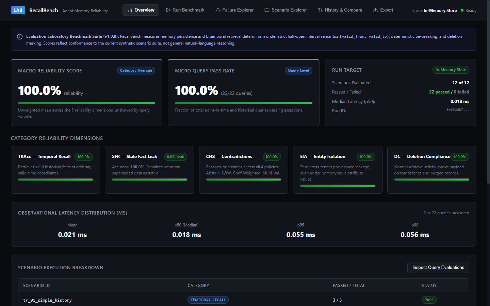
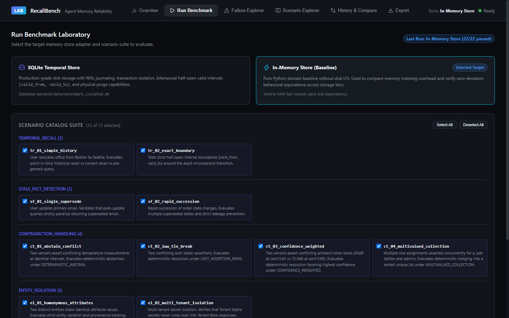
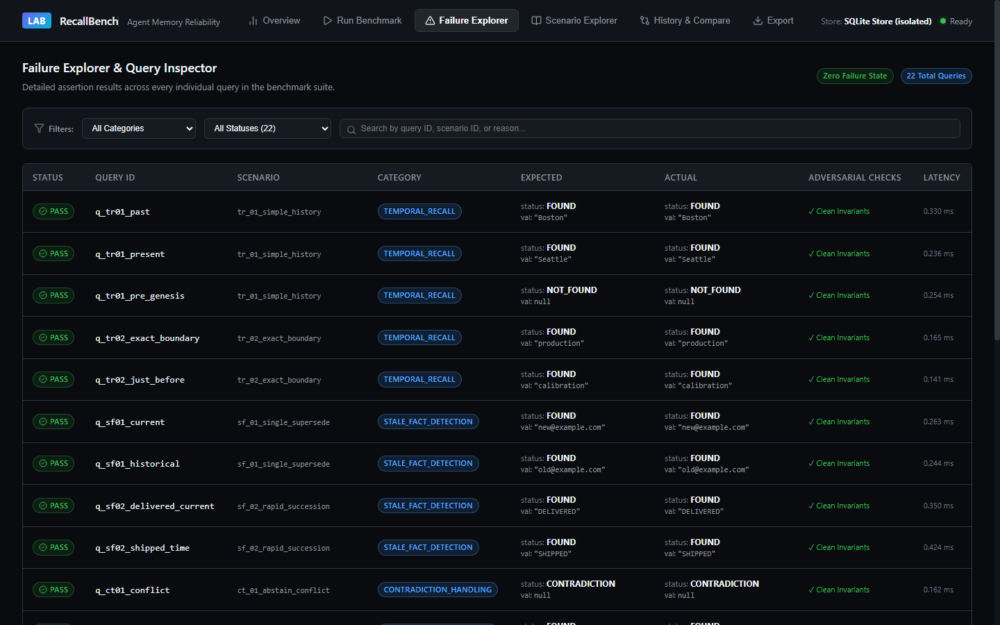
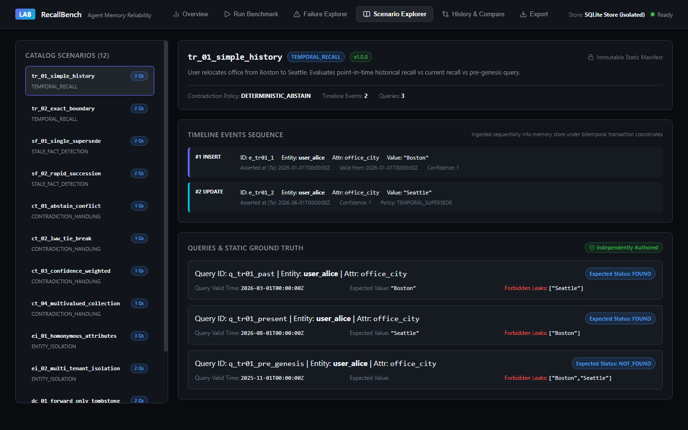
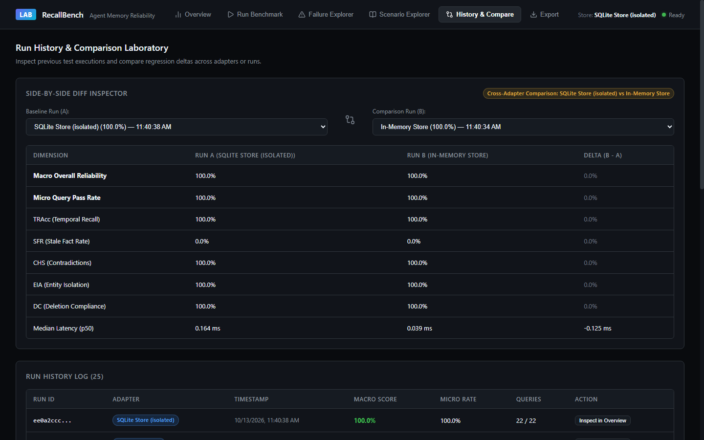
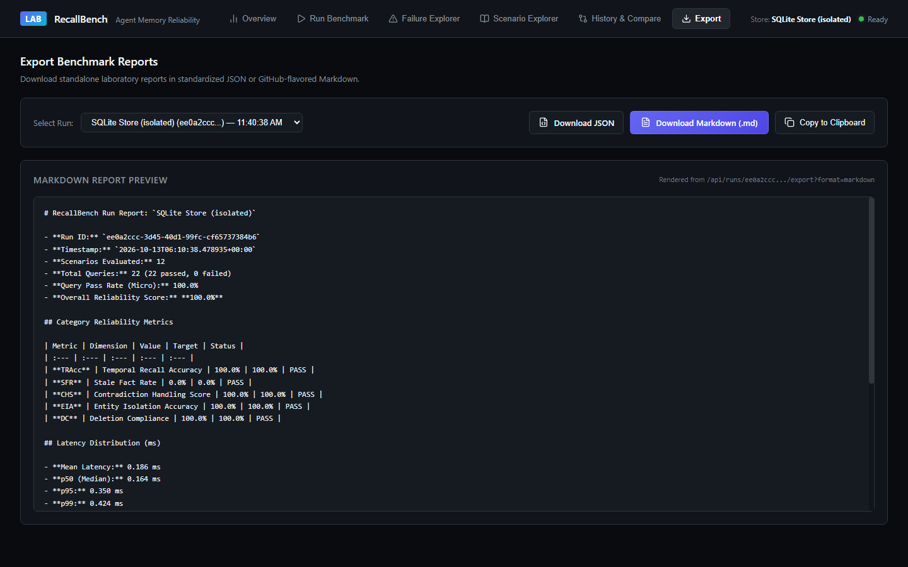
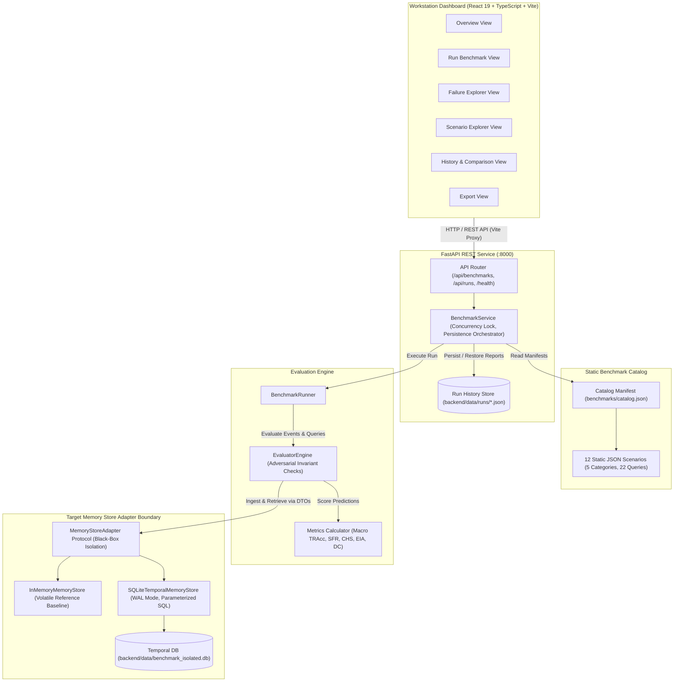

# RecallBench — Agent Memory Reliability Lab

[](https://www.python.org/downloads/)
[](https://fastapi.tiangolo.com/)
[](https://react.dev/)
[](https://www.typescriptlang.org/)
[](https://vitejs.dev/)
[](LICENSE)
[-success.svg)](backend/tests/)

RecallBench is a local-first, deterministic evaluation laboratory engineered to assess whether AI agent memory systems reliably retain, update, retrieve, and forget structured facts over time.

---

## 1. Problem Statement

Modern AI agent architectures frequently treat memory as an undifferentiated vector store or conversational context buffer. While vector similarity search excels at semantic matching, it does not enforce the mathematical and logical invariants required for reliable long-term agent state:

1. **Temporal Amnesia & Leakage:** When an agent updates a fact (e.g., an office location changes from Boston to Seattle at time $T$), queries inquiring about historical state as of $T_{past} < T$ fail or mistakenly leak future truth.
2. **Stale-Fact Hallucination:** Agents repeatedly retrieve superseded attributes (e.g., outdated credentials, former phone numbers, previous addresses) and treat them as currently valid truth.
3. **Contradiction Ambiguity:** When conflicting assertions arrive concurrently (e.g., multi-sensor readings or competing user instructions), stores lack deterministic resolution policies, resulting in unpredictable non-deterministic state.
4. **Entity Cross-Contamination:** Homonymous attribute keys across distinct users or multi-tenant sessions (e.g., two users who both have an attribute named `theme = "dark"` or `api_key`) leak values across tenant boundaries due to improper predicate scoping.
5. **Deletion Non-Compliance:** Logical soft-deletion or GDPR-mandated erasure requests are bypassed by normal semantic search, exposing tombstoned or purged records during routine retrieval.

**Memory reliability is not an open-ended retrieval game; it is an invariant-preserving storage problem.** RecallBench formalizes memory evaluation using bitemporal mathematics, half-open valid-time intervals $[valid\_from, valid\_to)$, deterministic contradiction resolution policies, and provable deletion masking.

---

## 2. Key Capabilities

- **Strict Bitemporal Coordinates:** Evaluates world validity time $[valid\_from, valid\_to)$ completely decoupled from system transaction time $[asserted\_at, retracted\_at)$ in UTC.
- **Deterministic Contradiction Policies:** Rigorously verifies four explicit resolution policies: `DETERMINISTIC_ABSTAIN`, `LAST_ASSERTION_WINS`, `CONFIDENCE_WEIGHTED`, and `MULTIVALUED_COLLECTION`.
- **Decoupled Black-Box Adapter Protocol:** Evaluates target stores strictly through the `MemoryStoreAdapter` protocol. Predictions are returned as pure data transfer objects without leaking storage cursors or internal dictionaries.
- **Adversarial Evaluation Engine:** Injects adversarial mutation tests to prove the evaluation harness catches off-by-one boundary errors, stale-fact leaks, cross-entity provenance contamination, and soft-delete disclosures.
- **Dual Reporting Metrics:** Distinguishes unweighted **Macro Reliability Score** (category mean) from **Micro Query Pass Rate** (fraction of total queries passing).
- **Dual Reference Implementations:** Includes both a volatile in-memory reference store (`InMemoryMemoryStore`) and a persistent SQLite reference store (`SQLiteTemporalMemoryStore`) with WAL journaling and parameterized queries.
- **Workstation UI Dashboard:** Premium dark graphite interface (`#090b0e`) featuring an executive scoreboard, scenario timeline inspector, query-level failure explorer, run diff inspector, and JSON/Markdown export.
- **Local-First & ₹0 Budget:** Zero external LLM calls in the evaluation loop, zero cloud infrastructure, zero paid APIs, and zero vector database dependencies.

---

## 3. Workstation Dashboard

The dashboard provides an interactive evaluation workstation for running benchmark suites, comparing adapter regressions, and inspecting query-level timelines:

### Overview & Scoreboard
Displays the unweighted Macro Reliability Score, Micro Query Pass Rate, dimension-by-dimension scores, observational latency distribution, and scenario execution breakdowns:


### Benchmark Execution Lab
Configures target store adapters (SQLite Temporal Store vs. In-Memory Store) and selects scenario subsets under concurrency locks:


### Failure Explorer & Query Inspector
Inspects assertion outcomes across every individual query with query-level filtering by category, status, and adversarial leak type:


### Scenario Explorer & Timeline Inspector
Examines scenario manifests, bitemporal event timelines, half-open validity intervals, and independently authored ground-truth expectations:


### Run History & Side-by-Side Diff Inspector
Compares completed evaluation runs across storage adapters to highlight regression deltas and latency shifts:


### Report Export
Generates downloadable, standardized evaluation artifacts in raw JSON and GitHub-flavored Markdown:


---

## 4. Architecture Overview



---

## 5. Evaluation Categories and Metrics

RecallBench measures memory reliability across five distinct dimensions:

| Category | Metric | Definition & Formula | Target | Failure Mode Penalized |
| :--- | :--- | :--- | :--- | :--- |
| **Temporal Recall** | **TRAcc** | $\frac{\text{Queries Valid at } T_v}{\text{Total Point-in-Time Queries}}$ | **100.0%** | Temporal Amnesia, pre-genesis leaks, boundary collisions. |
| **Stale-Fact Detection** | **SFR** | $\frac{\text{Queries Leaking Superseded Facts}}{\text{Total Post-Update Queries}}$ | **0.0%** | Stale-fact hallucination, returning outdated versions. |
| **Contradiction Handling** | **CHS** | $\frac{\text{Correctly Resolved or Abstained}}{\text{Total Contradictory Ingestions}}$ | **100.0%** | Arbitrary tie-breaking, non-deterministic conflict guessing. |
| **Entity Isolation** | **EIA** | $\frac{\text{Queries with Zero Tenant Crossover}}{\text{Total Multi-Tenant Queries}}$ | **100.0%** | Tenant crosstalk, homonymous attribute value confusion. |
| **Deletion Compliance** | **DC** | $\frac{\text{Queries Returning Masked Payloads}}{\text{Total Post-Deletion Queries}}$ | **100.0%** | Soft-delete leakage, GDPR retroactive purge violations. |

### Macro vs. Micro Scoring
- **Macro Reliability Score:** Unweighted arithmetic mean across the five category scores:
  $$\text{MacroScore} = \frac{\text{TRAcc} + (1 - \text{SFR}) + \text{CHS} + \text{EIA} + \text{DC}}{5}$$
  Prevents high-volume query categories from masking catastrophic failures in low-volume categories.
- **Micro Query Pass Rate:** Raw fraction of total individual queries passing assertions:
  $$\text{MicroRate} = \frac{\sum \text{Queries Passed}}{\sum \text{Total Queries}}$$

### Observational Latency Distribution
Latency is captured empirically (Mean, p50, p95, p99) per query. It is recorded as an observational system characteristic rather than a synthetic pass/fail threshold, ensuring tests remain deterministic across varied hardware environments.

---

## 6. Benchmark Scenarios (12 Scenarios, 22 Queries)

All scenarios are authored as static, versioned JSON manifests in [`benchmarks/v1/`](benchmarks/v1/):

| ID | Category | Queries | Description |
| :--- | :--- | :---: | :--- |
| `tr_01_simple_history` | Temporal Recall | 3 | Office relocation (Boston $\to$ Seattle). Point-in-time past, present, and pre-genesis queries. |
| `tr_02_exact_boundary` | Temporal Recall | 2 | Half-open intervals $[valid\_from, valid\_to)$ evaluated at exact microsecond transition boundaries. |
| `sf_01_single_supersede` | Stale-Fact Detection | 2 | Primary email update. Ensures post-update query penalizes returning the superseded address. |
| `sf_02_rapid_succession` | Stale-Fact Detection | 2 | Rapid chain of order status changes (`PENDING` $\to$ `SHIPPED` $\to$ `DELIVERED`). |
| `ct_01_abstain_conflict` | Contradiction Handling | 1 | Sensor temperature conflict at identical validity. Evaluates `DETERMINISTIC_ABSTAIN`. |
| `ct_02_lww_tie_break` | Contradiction Handling | 1 | Conflicting auth tokens. Evaluates `LAST_ASSERTION_WINS` with deterministic tie-breaking. |
| `ct_03_confidence_weighted` | Contradiction Handling | 1 | Conflicting ambient noise levels (45dB @ 0.65 vs. 72.5dB @ 0.95). Evaluates `CONFIDENCE_WEIGHTED`. |
| `ct_04_multivalued_collection` | Contradiction Handling | 1 | Concurrent role assignments (`editor` and `admin`). Evaluates `MULTIVALUED_COLLECTION` sorted set. |
| `ei_01_homonymous_attributes` | Entity Isolation | 3 | Two distinct entities sharing identical attribute values. Evaluates provenance isolation. |
| `ei_02_multi_tenant_isolation` | Entity Isolation | 2 | Multi-tenant secret isolation. Verifies Tenant Alpha secrets never leak to Tenant Beta. |
| `dc_01_forward_only_tombstone` | Deletion Compliance | 2 | Forward-only customer plan deletion. Preserves historical validity while masking future queries. |
| `dc_02_retroactive_gdpr_purge` | Deletion Compliance | 2 | GDPR retroactive purge of passport number. Masks past and future queries to `None`. |
| **Total** | **5 Categories** | **22** | **12 Scenarios, 22 Queries** |

---

## 7. Technology Stack

- **Backend:** Python 3.11+, [FastAPI](https://fastapi.tiangolo.com/), [Pydantic V2](https://docs.pydantic.dev/), [Uvicorn](https://www.uvicorn.org/)
- **Testing & Tooling:** [pytest](https://docs.pytest.org/), [httpx](https://www.python-httpx.org/), [httpx2](https://pypi.org/project/httpx2/) (for Starlette TestClient)
- **Persistence:** Python standard library `sqlite3` in WAL mode (no heavy ORM)
- **Frontend:** [React 19](https://react.dev/), [TypeScript](https://www.typescriptlang.org/), [Vite 8](https://vitejs.dev/), [Lucide React](https://lucide.dev/)
- **Styling:** Custom Workstation CSS design system with CSS custom properties

---

## 8. Installation & Setup

### Prerequisites
- Python 3.11+
- Node.js 18+ and npm
- Windows PowerShell (or standard bash on Linux/macOS)

### 1. Backend Setup
Clone the repository and set up a Python virtual environment:

```powershell
# Create virtual environment
python -m venv .venv

# Activate virtual environment
.\.venv\Scripts\Activate.ps1

# Install declared dependencies
pip install -r backend\requirements.txt
```

### 2. Frontend Setup
Install frontend dependencies:

```powershell
cd frontend
npm install
cd ..
```

---

## 9. Running the Laboratory

### Starting the Backend API
Run the FastAPI backend on port 8000:

```powershell
$env:PYTHONPATH='backend'
.\.venv\Scripts\python.exe -m uvicorn app.main:app --host 127.0.0.1 --port 8000
```
- API Health: `http://127.0.0.1:8000/health`
- Interactive Swagger Docs: `http://127.0.0.1:8000/docs`

### Starting the Frontend Dashboard
In a separate terminal, launch the Vite development server on port 5173:

```powershell
cd frontend
npm run dev
```
- Dashboard URL: `http://127.0.0.1:5173`
*(Vite proxies `/api` and `/health` requests directly to `http://127.0.0.1:8000`)*

---

## 10. Verification & Testing

### Running Backend Tests
Execute the complete 128-test backend test suite:

```powershell
.\.venv\Scripts\pytest.exe -v
```
Output:
```text
============================= 128 passed in 2.23s =============================
```

### Building Frontend Production Bundle
Verify TypeScript type-checking and create the production bundle:

```powershell
cd frontend
npm run build
cd ..
```
Output:
```text
✓ 1915 modules transformed.
dist/index.html                   0.49 kB
dist/assets/index-SvYQOlhq.css    5.88 kB
dist/assets/index-BDjOBK8E.js   275.24 kB
✓ built in 1.11s
```

### Running Automated Browser Smoke Test
RecallBench includes an end-to-end browser smoke test driven via the Chrome DevTools Protocol (CDP) that validates all 6 views and captures high-resolution screenshot evidence:

```powershell
powershell -ExecutionPolicy Bypass -File scripts\run_browser_smoke_test.ps1
```

---

## 11. Example Benchmark Workflow via API

Execute runs and export reports directly via the REST API:

```powershell
# 1. Inspect catalog
curl -X GET http://127.0.0.1:8000/api/benchmarks

# 2. Trigger SQLite benchmark run
curl -X POST http://127.0.0.1:8000/api/runs `
  -H "Content-Type: application/json" `
  -d '{"adapter": "sqlite"}'

# 3. List completed runs
curl -X GET http://127.0.0.1:8000/api/runs

# 4. Export report as Markdown
curl -X GET "http://127.0.0.1:8000/api/runs/<RUN_ID>/export?format=markdown" `
  -o "recallbench_report.md"
```

---

## 12. Security, Privacy, and Local-First Design

- **100% Local Execution:** Evaluates memory stores locally without transmitting data over external networks.
- **Zero Paid APIs or Telemetry:** No third-party analytics, tracking tokens, or hidden external requests.
- **Injection Safety:** All SQLite persistence operations use strictly parameterized SQL queries.
- **Code Execution Safety:** The evaluation engine strictly avoids dynamic Python code execution (`eval`, `exec`, `compile`).
- **Storage Isolation:** Benchmark temporal memories (`backend/data/benchmark_isolated.db`) are physically isolated from run history reports (`backend/data/runs/`).

---

## 13. Known Limitations

RecallBench discloses its architectural boundaries honestly:

1. **Synthetic Structured Benchmarks:** The benchmark currently evaluates structured fact ingestion and bitemporal predicate retrieval. It does not measure prompt extraction noise, natural language ambiguity, or conversational context retrieval in live LLMs.
2. **Reference Implementations:** The included `InMemoryMemoryStore` and `SQLiteTemporalMemoryStore` adapters are deterministic reference implementations designed to establish an invariant baseline. A 100% reliability score on these stores demonstrates adapter conformance to mathematical bitemporal specifications, not general AI conversational capability.
3. **Current Catalog Population:** Version 1.0.0 contains 12 scenarios and 22 queries targeting specific edge cases (exact interval boundaries, rapid succession, GDPR retroactive purges). Real-world applications require expanding the scenario catalog to domain-specific workloads.
4. **Physical Deletion Disclaimer:** While retroactive deletion tombstones prohibit logical retrieval across valid-time coordinates, standard SQLite row deletion does not constitute cryptographic or forensic data sanitization.

---

## 14. Project Status

RecallBench V1.0.0 is feature-complete, deterministically verified, and ready for use as an evaluation harness for AI agent memory systems.

---

## 15. License

MIT License. See [LICENSE](LICENSE) for details.
